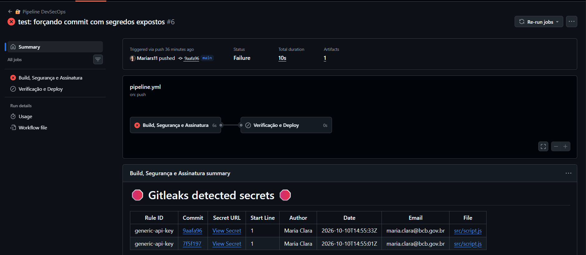
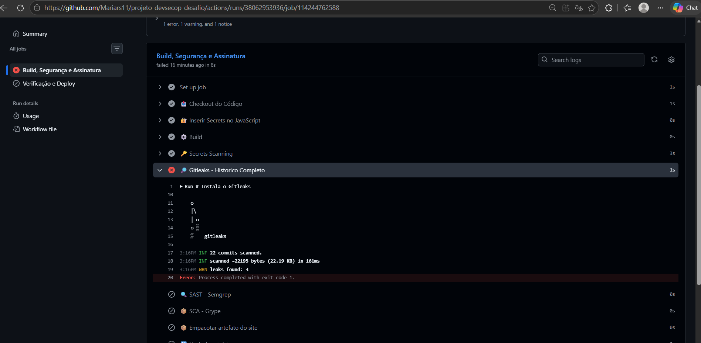

# Desafio DevSecOps — ADA Tech

## Sobre o projeto

Projeto desenvolvido para o desafio do módulo de DevSecOps da ADA Tech.

A proposta é implementar uma pipeline no GitHub Actions com ferramentas de segurança, identificar vulnerabilidades, corrigir os problemas encontrados e realizar o deploy no GitHub Pages.

O principal objetivo é aplicar o conceito de **Break the Build**, interrompendo a pipeline quando forem encontradas vulnerabilidades.

## Status do desafio

- [x] Implementar Gitleaks para detectar secrets
- [x] Verificar o histórico Git com Gitleaks
- [x] Configurar GitHub Actions Secrets
- [x] Remover secrets do histórico Git
- [x] Implementar Semgrep
- [x] Corrigir o uso de `eval()`
- [x] Implementar Grype
- [x] Atualizar as dependências vulneráveis
- [x] Corrigir a action vulnerável do GitHub Actions
- [x] Validar Gitleaks, Semgrep e Grype
- [x] Corrigir o uso de `innerHTML` com entrada do usuário
- [x] Corrigir a exposição de `err.stack`
- [ ] Implementar assinatura real com Cosign
- [ ] Verificar a assinatura do artefato
- [ ] Finalizar o deploy no GitHub Pages

Na execução **#14**, o job de build e segurança passou por todas as etapas. O job de verificação e deploy ainda apresentou erro.

## Pipeline

O workflow está no arquivo `.github/workflows/pipeline.yml` e possui dois jobs:

**Build, Segurança e Assinatura:** prepara os arquivos, executa os scanners, gera o artefato e realiza a etapa atual de assinatura.

**Verificação e Deploy:** recebe o artefato e executa as etapas de verificação e publicação no GitHub Pages.

### 1. Gitleaks — Secrets Scanning

O Gitleaks foi configurado para detectar credenciais expostas no repositório.

Nos primeiros testes, encontrou duas ocorrências no `src/script.js` e bloqueou a pipeline.

Também foi adicionada uma verificação do histórico completo:

```bash
gitleaks git . --redact --exit-code 1
```

Essa análise encontrou três ocorrências em commits antigos.

**Correção:** as credenciais foram substituídas por marcadores no JavaScript. Os valores de demonstração são configurados no GitHub Actions Secrets e inseridos durante a pipeline com `env` e `sed`.

Como o JavaScript será público, foram utilizados apenas valores fictícios.

Para remover os valores antigos do histórico, foi utilizado o `git-filter-repo`:

```powershell
git filter-repo --replace-text ..\substituicoes.txt --force
```

Após a limpeza, as duas etapas do Gitleaks passaram.

### 2. Semgrep — SAST

O Semgrep foi configurado para analisar o código da aplicação:

```bash
semgrep scan --config auto --config p/xss --error src/
```

No primeiro teste, encontrou o uso inseguro de `eval()` no arquivo `src/script.js`, bloqueando a pipeline.

**Antes:**

```javascript
eval('console.log("Tarefa adicionada: ' + input.value + '")');
```

**Depois:**

```javascript
console.log('Tarefa adicionada:', input.value);
```

Após a correção, o Semgrep analisou quatro arquivos com 218 regras e apresentou **0 findings**.

### 3. Grype — SCA

O Grype foi configurado para identificar vulnerabilidades nas dependências:

```bash
grype dir:. --fail-on medium
```

O primeiro teste encontrou vulnerabilidades em bibliotecas como `lodash`, `axios`, `express` e suas dependências.

Para corrigir, as bibliotecas foram atualizadas, mantendo os pacotes do exercício:

```bash
npm install lodash@latest axios@latest express@latest --save-exact
```

Depois da atualização, restou apenas um alerta relacionado à action `actions/download-artifact@v4`.

A referência foi atualizada para `actions/download-artifact@v4.1.3`.

Na execução **#14**, o Grype passou.

### 4. Correções adicionais no JavaScript

Durante a revisão manual do `src/script.js`, foram identificados outros dois pontos de segurança que não haviam sido apontados pelo Semgrep.

**Uso de `innerHTML`:** a entrada digitada pelo usuário era inserida diretamente no HTML da página, podendo permitir XSS.

A correção foi utilizar `createElement()` e `textContent` para exibir o texto sem interpretá-lo como HTML.

```javascript
const li = document.createElement('li');
li.textContent = input.value;
output.replaceChildren(li);
```

**Exposição de `err.stack`:** os detalhes internos de erros eram exibidos diretamente na página.

A correção foi registrar o erro no console e mostrar uma mensagem simples ao usuário.

```javascript
console.error('Erro ao carregar tarefas:', err);

document.getElementById('db-status').innerText =
    'Nao foi possivel carregar as tarefas.';
```

Essas alterações foram realizadas como melhorias de segurança identificadas na revisão do código.

### 5. Artefato e Cosign

Após as verificações, a pipeline gera o arquivo `artifact.tar` e seu hash SHA256.

A instalação do Cosign já funciona, mas a assinatura ainda é simulada. A assinatura real e sua verificação serão implementadas nas próximas etapas.

### 6. GitHub Pages

A estrutura de deploy está no workflow.

Na execução #14, o job **Build, Segurança e Assinatura** foi aprovado, mas **Verificação e Deploy** falhou.

O erro ainda será analisado.

## Evidências

As capturas de tela estão na pasta `evidencias/`.

### Gitleaks

**Detecção de secrets:** [Execução no GitHub Actions](https://github.com/Mariars11/projeto-devsecop-desafio/actions/runs/38061554071)

Commit do teste: [9aafa96](https://github.com/Mariars11/projeto-devsecop-desafio/commit/9aafa96bcfd33258690e3e0e2db628f18b182c11)



**Bloqueio por secrets no histórico:** [Execução no GitHub Actions](https://github.com/Mariars11/projeto-devsecop-desafio/actions/runs/38062953936)



### Semgrep

**Detecção do `eval()`:** [Execução no GitHub Actions](https://github.com/Mariars11/projeto-devsecop-desafio/actions/runs/38060426096)

Commit do teste: [452d2f1](https://github.com/Mariars11/projeto-devsecop-desafio/commit/452d2f1725c20b062cd929611122a622f0374336)

### Grype

**Detecção das dependências vulneráveis:** [Execução no GitHub Actions](https://github.com/Mariars11/projeto-devsecop-desafio/actions/runs/38060743966)

Commit do teste: [3788e57](https://github.com/Mariars11/projeto-devsecop-desafio/commit/3788e57d038f6f0309e3ba9b3faf6854e4d1c4b6)

### Gerenciamento de Secrets

[Execução de teste no GitHub Actions](https://github.com/Mariars11/projeto-devsecop-desafio/actions/runs/38063731291)

O step de substituição dos marcadores passou, mas o histórico ainda continha secrets. Depois da limpeza com `git-filter-repo`, o Gitleaks também passou.

**Observação:** alguns links de commits antigos podem não funcionar após a reescrita do histórico Git. Foram mantidos como referência dos testes realizados.

## Próximos passos

Implementar a assinatura real do artefato com Cosign, ativar sua verificação e resolver o erro do job de deploy.

Depois, validar a publicação no GitHub Pages e registrar o resultado final da pipeline.

## URL de produção

Será adicionada após a publicação no GitHub Pages.
